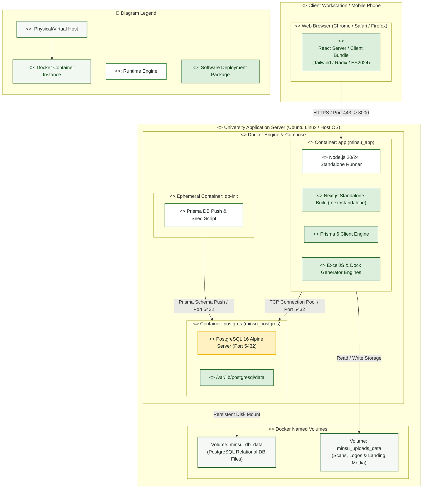
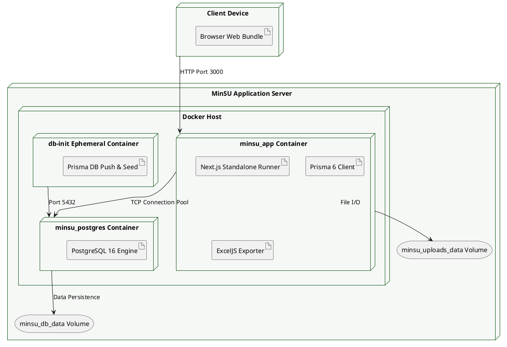

# Deployment Diagram

> **System:** MinSU DocTrack  
> **Diagram Type:** Deployment Diagram  
> **Standard:** UML 2.5 Deployment Specification

---

## 1. Purpose

The Deployment Diagram shows where software artifacts run on hardware and container nodes. It shows ports, runtimes, container configurations, and persistent storage volumes.

---

## 2. Mermaid Deployment Diagram

---

## 3. Diagram Legend & Symbol Guide

| Visual Symbol | UML Deployment Concept | MinSU System Implementation |
|---|---|---|
| `<<device>>` | Hardware or Virtual Host | Client browser device, Docker Host server |
| `<<node>>` | Execution Node | Docker containers: `app`, `postgres`, `db-init` |
| `<<executionEnvironment>>` | Software Runtime | Node.js standalone runtime, PostgreSQL 16 Alpine |
| `<<artifact>>` | Compiled Binary or Package | Next.js standalone bundle, Prisma 6 client, ExcelJS exporter |
| `<<storage>>` | Persistent Storage Volume | `minsu_db_data`, `minsu_uploads_data` |

---

## 4. PlantUML Deployment Diagram

