# Interaction Overview Diagram: MinSU DocTrack Whole System

## 1. Description
This interaction overview diagram combines high-level decision logic with sequence interaction frames to orchestrate the entire institutional lifecycle of the Tulong Dunong Program (TDP). It models the transitions between authentication with 2FA, student intake, registration validation, 3-way tripartite verification, executive approval, multi-tab Excel export, and external transmittal.

## 2. ASD-STE100 Technical Specifications
- Structure major interaction stages inside sequence frames (`sd`).
- Model control flow between frames using activity decision diamonds.
- Include explicit error and revision loops for non-compliant states.
- Connect the final operational step to a terminal node.

---

## 3. System Interaction Overview Diagram (Mermaid)

```mermaid
graph TD
    StartNode([Start: Semester TDP Cycle Initiated]) --> Frame_Auth["sd: AuthenticateAndAuthorize<br/>- Validate session cookie & 2FA TOTP<br/>- Enforce RBAC permissions"]

    Frame_Auth --> Frame_Call["sd: PublishApplicantCall<br/>- Set slot quotas and submission deadline<br/>- Display on public landing page"]

    Frame_Call --> Frame_Intake["sd: StudentApplicationIntake<br/>- Student registers & enters academic data<br/>- Uploads proof PDFs (<= 5MB)<br/>- Issues tracking code & printable slip"]

    Frame_Intake --> Frame_ValReg["sd: ValidateRegistrationQueue<br/>- Staff validates applications at /registrations<br/>- Marks ACCEPTED / REJECTED<br/>- Locks student identity per RA 10173"]

    Frame_ValReg --> Frame_Verify["sd: TripartiteCrossMatch<br/>- Upload CHED & Registrar CSV datasets<br/>- Compute fuzzy match confidence scores<br/>- Resolve candidate discrepancies"]

    Frame_Verify --> Frame_Compile["sd: CompileBillingPackage<br/>- Import verified grantees into Annex 4<br/>- Submit to Executive Review Queue"]

    Frame_Compile --> Decision_Director{"Does Director Approve Document?"}

    Decision_Director -->|No| Frame_Return["sd: ProcessRevision<br/>- Notify coordinator of required changes<br/>- Reopen package for editing"]
    Frame_Return --> Frame_Compile

    Decision_Director -->|Yes| Frame_Approve["sd: ExecutiveEndorsement<br/>- Stamp digital signature & verification hash<br/>- Lock masterlist against modifications<br/>- Record audit event"]

    Frame_Approve --> Frame_Financial["sd: AccountingReconciliation<br/>- Prepare Annex 9 Payroll & Annex 6 Ledgers<br/>- Validate zero variance (0.00 PHP)"]

    Frame_Financial --> Decision_Variance{"Is Variance == 0.00 PHP?"}

    Decision_Variance -->|No| Frame_FixFin["sd: AdjustLedger<br/>- Highlight red cells & prompt officer balance"]
    Frame_FixFin --> Frame_Financial

    Decision_Variance -->|Yes| Frame_Excel["sd: StreamExcelJSWorkbooks<br/>- Export 3-tab Annex 4 & Annex 9 workbooks<br/>- Generate Annex 10 Word letters"]

    Frame_Excel --> Frame_Dispatch["sd: DispatchTransmittal<br/>- Upload wet-signed physical document scan<br/>- Bind courier tracking & Drive link<br/>- Deliver package to CHED / UniFAST"]

    Frame_Dispatch --> EndNode([End: Cycle Completed & Records Archived])

    %% ─── 📌 VISUAL LEGEND ───
    subgraph Legend ["📌 Diagram Legend"]
        direction TB
        L_Frame["sd: InteractionFrame<br/>(Sub-sequence scenario)"]:::legFrame
        L_Dec{"{Decision Node}"}:::legDec
        L_Term(["([Terminal / End])"]):::legTerm
        L_Frame --> L_Dec
        L_Dec -->|Yes| L_Term
    end
    classDef legFrame fill:#F1F8F1,stroke:#1B5E20,color:#1F2A24;
    classDef legDec fill:#FFF1C2,stroke:#B88A00,color:#1F2A24;
    classDef legTerm fill:#123F17,stroke:#1B5E20,color:#fff;
```

---

## 4. Diagram Legend & Symbol Guide

| Visual Symbol | Syntax / Style | UML Concept | MinSU Implementation Context |
|---|---|---|---|
| `sd: Frame` | `["sd: Name Summary"]` | Interaction Sequence Frame | High-level sequence chunk: Intake, 3-Way Match, Excel Export |
| `{Decision}` | `{"Decision Question?"}` | Decision / Guard Node | Director Approval decision, Zero-variance balance check |
| `([Terminal])` | `(["Start / End"])` | Cycle Boundary Node | Semester cycle starts or fund disbursement concludes |
