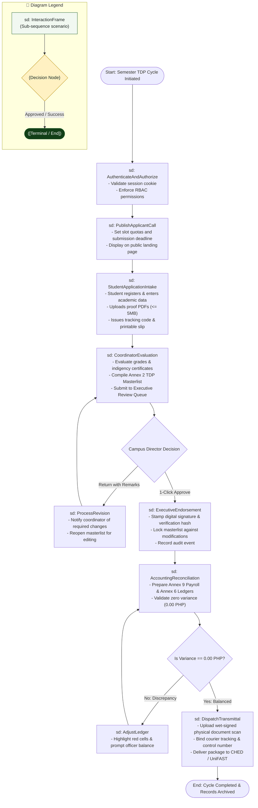

# Interaction Overview Diagram: MinSU DocTrack Whole System

## 1. Description
This interaction overview diagram combines high-level decision logic with sequence interaction frames to orchestrate the entire institutional lifecycle of the Tulong Dunong Program (TDP). It models the transitions between authentication, student onboarding, operational annex compilation, executive approval, financial disbursement, and external transmittal.

## 2. ASD-STE100 Technical Specifications
- Structure major interaction stages inside sequence frames (`sd`).
- Model control flow between frames using activity decision diamonds.
- Include explicit error and revision loops for non-compliant states.
- Connect the final operational step to a terminal node.

---

## 3. System Interaction Overview Diagram (Mermaid)

---

## 4. Diagram Legend & Symbol Guide

| Symbol / Element | Syntax / Type | Technical Meaning | MinSU Interaction Context |
|---|---|---|---|
| `sd: FrameName` | `["sd: ..."]` | Sequence interaction scenario frame | Encapsulates an entire sequence flow (e.g., `AuthenticateAndAuthorize`, `ExecutiveEndorsement`) |
| `{Decision}` | `{"Decision"}` | Activity decision branch point | Campus Director decision gate (`1-Click Approve` vs. `Return with Remarks`) |
| `([Pill Node])` | `([Start / End])` | Lifecycle start or terminal archive node | Initiating semester intake or locking final records in archive |
| `-->` Solid Arrow | Control Flow Connector | Sequential hand-off between interaction frames | Passing state from student intake to coordinator compilation |
| `-->\|Label\|` | Guarded Branch | Conditional scenario path | "Yes: Balanced", "No: Discrepancy", "Return with Remarks" |
| 🟢 Green Box | `#F1F8F1` / `#1B5E20` | Successful Workflow Phase | Forward operational processing and executive approval |
| 🟡 Gold Diamond | `#FFF1C2` / `#B88A00` | Critical Institutional Checkpoint | Campus Director review and zero-variance fiscal math check |

---

## 5. Interaction Frame Descriptions
- **AuthenticateAndAuthorize**: Enforces role access boundaries before permitting administrative actions.
- **PublishApplicantCall**: Establishes the digital intake parameters for the upcoming semester.
- **StudentApplicationIntake**: Allows students to submit credentials and receive instant tracking slips.
- **CoordinatorEvaluation**: Filters applicants against scholarship criteria and builds official masterlists.
- **ExecutiveEndorsement**: Provides the Campus Director with a rapid, secure approval interface.
- **AccountingReconciliation**: Enforces exact fiscal alignment between disbursements and government allocations.
- **DispatchTransmittal**: Concludes the semester cycle by delivering digital and physical records to CHED.
