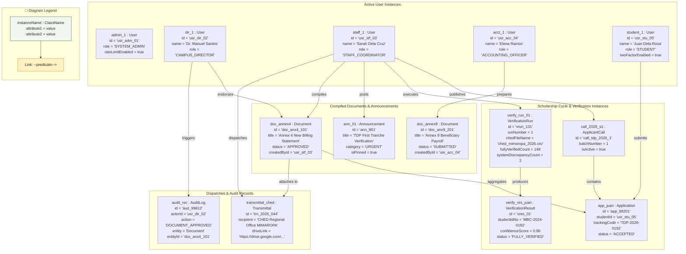

# Object Diagram: MinSU DocTrack Whole System

## 1. Description
This object diagram captures a runtime instance snapshot of the MinSU DocTrack system during mid-semester operations. It displays concrete instances of authenticated users across all roles, active scholarship calls, student applications, 3-way verification runs, campus announcements, financial ledgers, transmittals, and security audit logs.

## 2. ASD-STE100 Technical Specifications
- Show concrete object instances with explicit identity attributes.
- Include instances from all five system roles in an operational state.
- Trace links between student applications, 3-way verification runs, compiled annexes, and agency transmittals.
- Connect mutating operations directly to immutable audit log instances.

---

## 3. Object Diagram (Mermaid)

---

## 4. Diagram Legend & Symbol Guide

| Element | Format / Syntax | Technical Meaning | MinSU Implementation Context |
|---|---|---|---|
| Object Box | `[name : Class fields]` | Runtime instance in RAM/DB | `admin_1 : User`, `doc_annex4 : Document`, `verify_run_01 : VerificationRun` |
| Link Predicate | `-->\|predicate\|` | Concrete runtime association | `staffUser -->|executes| verifyRunObj` |
| State Snapshot | `status = 'APPROVED'` | Value of an instance variable | Mid-cycle point where verification is complete and billing approved |
