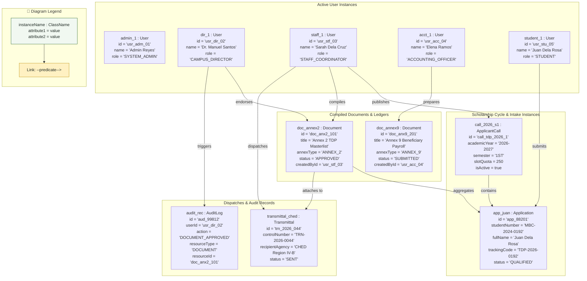
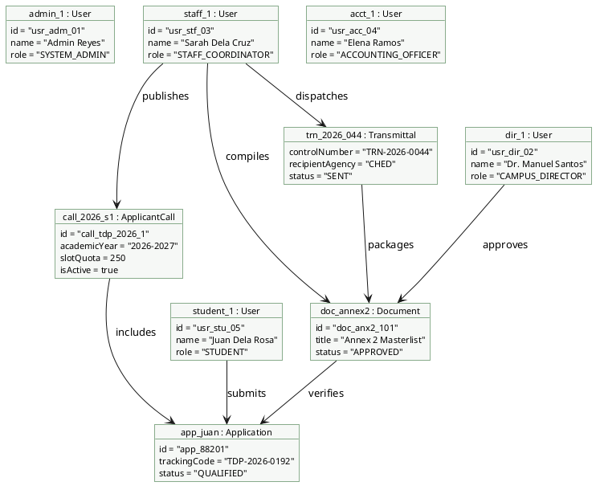

# Object Diagram: MinSU DocTrack Whole System

## 1. Description
This object diagram captures a runtime instance snapshot of the MinSU DocTrack system during mid-semester operations. It displays concrete instances of authenticated users across all roles, active scholarship calls, student applications, financial ledgers, transmittals, and security audit logs.

## 2. ASD-STE100 Technical Specifications
- Show concrete object instances with explicit identity attributes.
- Include instances from all five system roles in an operational state.
- Trace links between student applications, compiled annexes, and agency transmittals.
- Connect mutating operations directly to immutable audit log instances.

## 3. Object Diagram (Mermaid)

---

## 4. Diagram Legend & Symbol Guide

| Visual Symbol | Syntax / Format | UML Role | MinSU Instance Context |
|---|---|---|---|
| Instance Node | `instanceName : ClassName` | Concrete runtime instance in memory/DB | `dir_1 : User`, `call_2026_s1 : ApplicantCall`, `doc_annex2 : Document` |
| Attribute Values | `attr = 'value'` | Concrete state of instance properties | `status = 'APPROVED'`, `trackingCode = 'TDP-2026-0192'`, `slotQuota = 250` |
| `-->\|predicate\|` | Directed Association Link | Concrete relationship between runtime objects | `staffUser -->\|compiles\| annex2`, `dirUser -->\|endorses\| annex2` |
| Subgraph Boundary | `subgraph GroupName` | Domain grouping boundary | Active Users, Intake Instances, Compiled Annexes, Transmittal Audits |
| 🟢 Green Container | `#F1F8F1` / `#1B5E20` | Operational Domain Entities | Authenticated staff/director records and approved scholarship documents |
| 🟡 Gold Node | `#FFF1C2` / `#B88A00` | Financial & Security Linkages | Ledger documents and audit log event tracking |

---

## 5. PlantUML Alternative Syntax

---

## 6. Snapshot Integrity Verification
- **User Collaboration**: The staff coordinator compiles student applications into Annex 2, while the campus director approves the record.
- **Relational Integrity**: The transmittal record references the approved document ID.
- **Audit Consistency**: Every executive endorsement creates a linked audit log with the user identifier and resource timestamp.
