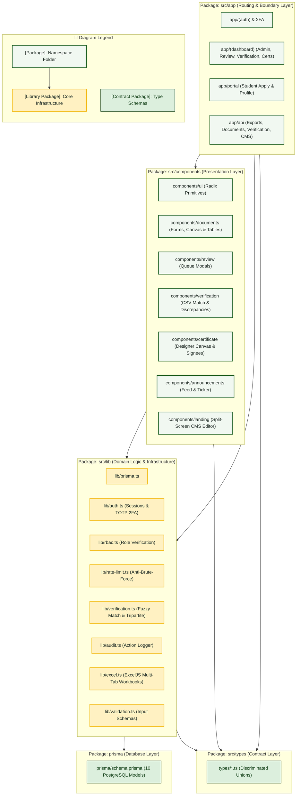
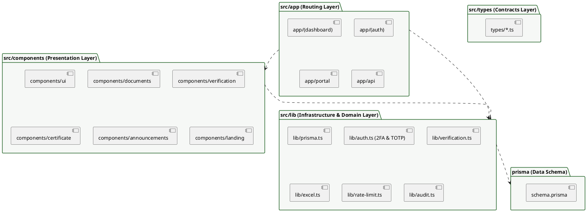

# Package Diagram

> **System:** MinSU DocTrack  
> **Diagram Type:** Package Diagram  
> **Standard:** UML 2.5 Package Specification

---

## 1. Purpose

The Package Diagram groups modules into logical packages. It shows the dependency arrows and prevents circular coupling between architectural layers.

---

## 2. Mermaid Package Diagram

---

## 3. Diagram Legend & Symbol Guide

| Visual Symbol | UML Package Concept | MinSU System Implementation |
|---|---|---|
| `Package` | Architectural Namespace | `src/app`, `src/components`, `src/lib`, `src/types`, `prisma` |
| `-->` | Directed Dependency | Consumer imports definitions from producer package |
| `Acyclic Rule` | Layered Architecture | `src/app` depends on `src/lib`, but `src/lib` never imports from `src/app` |

---

## 4. PlantUML Package Diagram

