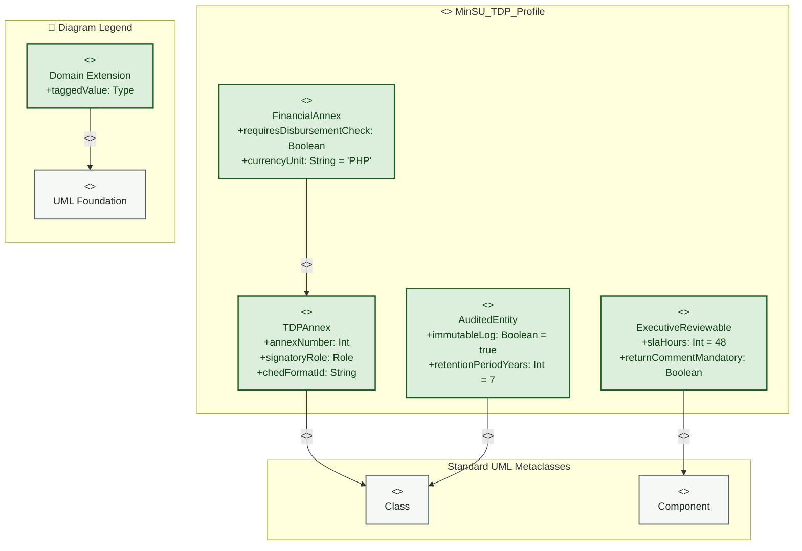

# Profile Diagram

> **System:** MinSU DocTrack  
> **Diagram Type:** UML Profile Diagram  
> **Target Domain:** MinSU Tulong Dunong Program (TDP) Governance

---

## 1. Purpose

The Profile Diagram defines domain-specific UML extensions for the MinSU Tulong Dunong Program. It defines stereotypes, metaclasses, and tagged values for institutional document governance.

---

## 2. Diagram



---

## 3. Diagram Legend & Symbol Guide

| Visual Symbol | Syntax / Style | UML Profile Mechanism | MinSU Governance Application |
|---|---|---|---|
| `<<metaclass>>` Box | `fill:#F6F8F6, stroke:#55645B` | Core UML base meta-element | Standard UML `Class` or `Component` |
| `<<stereotype>>` Box | `fill:#DCEFDD, stroke:#1B5E20` | Domain-specific extension | `<<TDPAnnex>>`, `<<FinancialAnnex>>`, `<<AuditedEntity>>`, `<<ExecutiveReviewable>>` |
| `+taggedValue: Type` | Tagged Value Attribute | Metadata property attached to stereotype | `annexNumber`, `signatoryRole`, `slaHours = 48`, `requiresDisbursementCheck` |
| `-- "<<extension>>" -->` | Extension Relationship | Extends metaclass semantics | Connects custom TDP stereotype to standard UML metaclass |
| `-- "<<generalization>>" -->` | Specialization Hierarchy | Stereotype inheritance | `FinancialAnnex` inherits all properties of `TDPAnnex` |

---

## 4. PlantUML Profile Specification

```plantuml
@startuml
skinparam packageBackgroundColor #FFFFFF
skinparam packageBorderColor #1B5E20

package "<<profile>> MinSU_TDP_Profile" {
  class "Class" <<metaclass>> as MetaClass
  class "Component" <<metaclass>> as MetaComponent

  class "TDPAnnex" <<stereotype>> {
    + annexNumber : Integer
    + signatoryRole : Role
    + chedFormatId : String
  }

  class "FinancialAnnex" <<stereotype>> {
    + requiresDisbursementCheck : Boolean
    + currencyUnit : String = "PHP"
  }

  class "AuditedEntity" <<stereotype>> {
    + immutableLog : Boolean = true
    + retentionPeriodYears : Integer = 7
  }

  class "ExecutiveReviewable" <<stereotype>> {
    + slaHours : Integer = 48
    + returnCommentMandatory : Boolean
  }

  TDPAnnex -up-> MetaClass : "<<extension>>"
  AuditedEntity -up-> MetaClass : "<<extension>>"
  ExecutiveReviewable -up-> MetaComponent : "<<extension>>"
  FinancialAnnex -up-|> TDPAnnex
}
@enduml
```

---

## 5. Stereotype Definitions & Tagged Values

| Stereotype | Extends | Tagged Values | Description |
|---|---|---|---|
| `<<TDPAnnex>>` | `Class` | `annexNumber: Int`, `signatoryRole: Role`, `chedFormatId: String` | Identifies official Tulong Dunong Program regulatory annex forms (Annexes 1–10). |
| `<<FinancialAnnex>>` | `<<TDPAnnex>>` | `requiresDisbursementCheck: Boolean`, `currencyUnit: String` | Specialized financial forms (Annexes 6, 7, 8, 9) that require peso balance verification. |
| `<<AuditedEntity>>` | `Class` | `immutableLog: Boolean`, `retentionPeriodYears: Int` | Marks database entities that must write immutable audit log events on every mutation. |
| `<<ExecutiveReviewable>>` | `Component` | `slaHours: Int`, `returnCommentMandatory: Boolean` | Identifies review queues requiring Campus Director endorsement before external release. |
