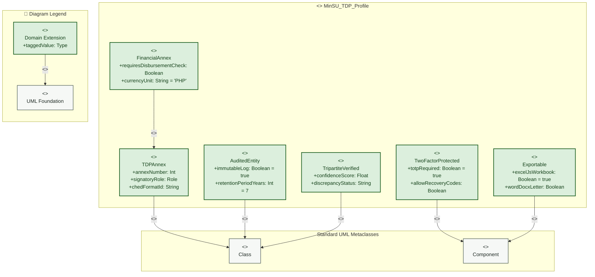
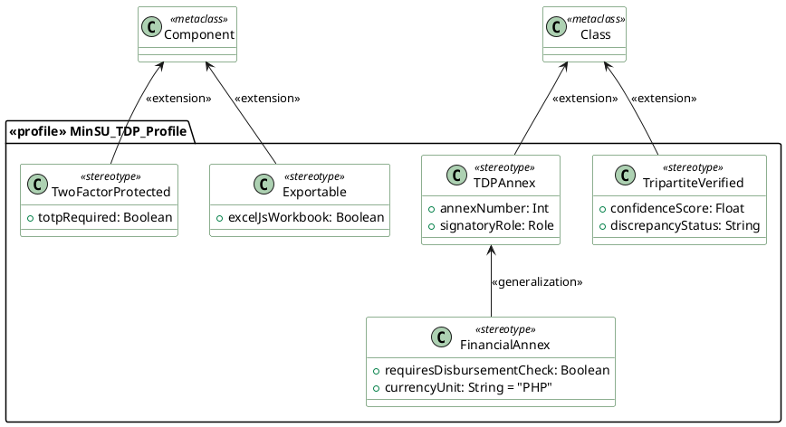

# Profile Diagram

> **System:** MinSU DocTrack  
> **Diagram Type:** UML Profile Diagram  
> **Target Domain:** MinSU Tulong Dunong Program (TDP) Governance

---

## 1. Purpose

The Profile Diagram defines domain-specific UML extensions for the MinSU Tulong Dunong Program. It defines stereotypes, metaclasses, and tagged values for institutional document governance, 3-way verification, two-factor security, and multi-format document generation.

---

## 2. Diagram

---

## 3. Diagram Legend & Symbol Guide

| Visual Symbol | Syntax / Style | UML Profile Mechanism | MinSU Governance Application |
|---|---|---|---|
| `<<metaclass>>` | `fill:#F6F8F6` | Core UML base meta-element | Standard UML `Class` or `Component` |
| `<<stereotype>>` | `fill:#DCEFDD` | Domain-specific extension | `TDPAnnex`, `FinancialAnnex`, `TripartiteVerified`, `TwoFactorProtected`, `Exportable` |
| `<<extension>>` | Solid Arrow | Metaclass specialization | Extends basic UML elements with custom TDP compliance metadata |
| `<<generalization>>` | Open Arrow | Stereotype inheritance | `FinancialAnnex` inherits general `TDPAnnex` properties |

---

## 4. PlantUML Profile Diagram

