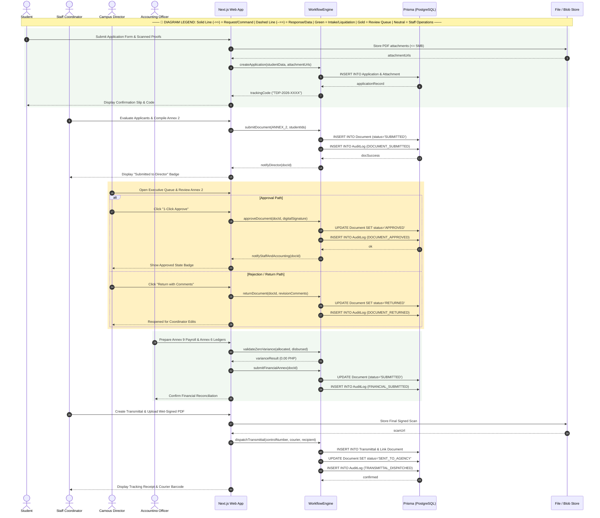

# Sequence Diagram: MinSU DocTrack Whole System

## 1. Description
This sequence diagram illustrates the chronological message exchange between actors, user interfaces, backend controllers, validation engines, database adapters, and external storage across a full document lifecycle.

## 2. ASD-STE100 Technical Specifications
- Order participants from left to right according to execution initiation.
- Draw synchronous calls with solid arrows and returns with dashed arrows.
- Enforce audit event emission for every status modification.
- Handle decision branches with `alt` and `opt` frames.

---

## 3. End-to-End System Sequence Diagram (Mermaid)

---

## 4. Diagram Legend & Symbol Guide

| Visual / Symbol | Element Type | Technical Role | MinSU DocTrack Context |
|---|---|---|---|
| 👤 `actor` | Human Actor | External user role triggering system operations | Student Applicant, Staff Coordinator, Campus Director, Accounting Officer |
| 🔲 `participant` | System Component | Internal software subsystem or persistence boundary | Next.js Web App, WorkflowEngine, Prisma/PostgreSQL, File/Blob Storage |
| ──▶ `->>` | Solid Arrow | Synchronous invocation or command message | Submitting application, calling `approveDocument()`, dispatching transmittal |
| - - ▷ `-->>` | Dashed Arrow | Return response or asynchronous receipt | Returning `trackingCode`, confirmation receipts, status badges |
| 🔲 `alt / else` | Conditional Fragment | Decision tree handling alternative workflow paths | Campus Director approving document vs. returning with revision notes |
| 🟩 `rect rgb(241, 248, 241)` | Soft Green Container | MinSU Approved / Intake Phase | Successful student application submission & accounting liquidation |
| 🟨 `rect rgb(255, 241, 194)` | Soft Gold Container | MinSU Review / Pending SLA Phase | Campus Director executive review queue & endorsement evaluation |
| ⬜ `rect rgb(255, 255, 255)` | Neutral Container | Staff Operations Phase | Staff Annex 2 compilation & courier agency transmittal dispatch |

---

## 5. Key Transaction Boundaries
- **Intake Transaction**: Atomic insertion of student demographic data, file references, and generated tracking tokens.
- **Executive Approval Transaction**: Synchronous update of document status, creation of status history rows, and recording of immutable audit logs.
- **Financial Validation Boundary**: Mathematical check rejecting any payload where `allocatedFund - disbursedAmount != 0.00`.
- **Transmittal Packaging**: Association of the physical scanned PDF with external courier tracking metadata.
