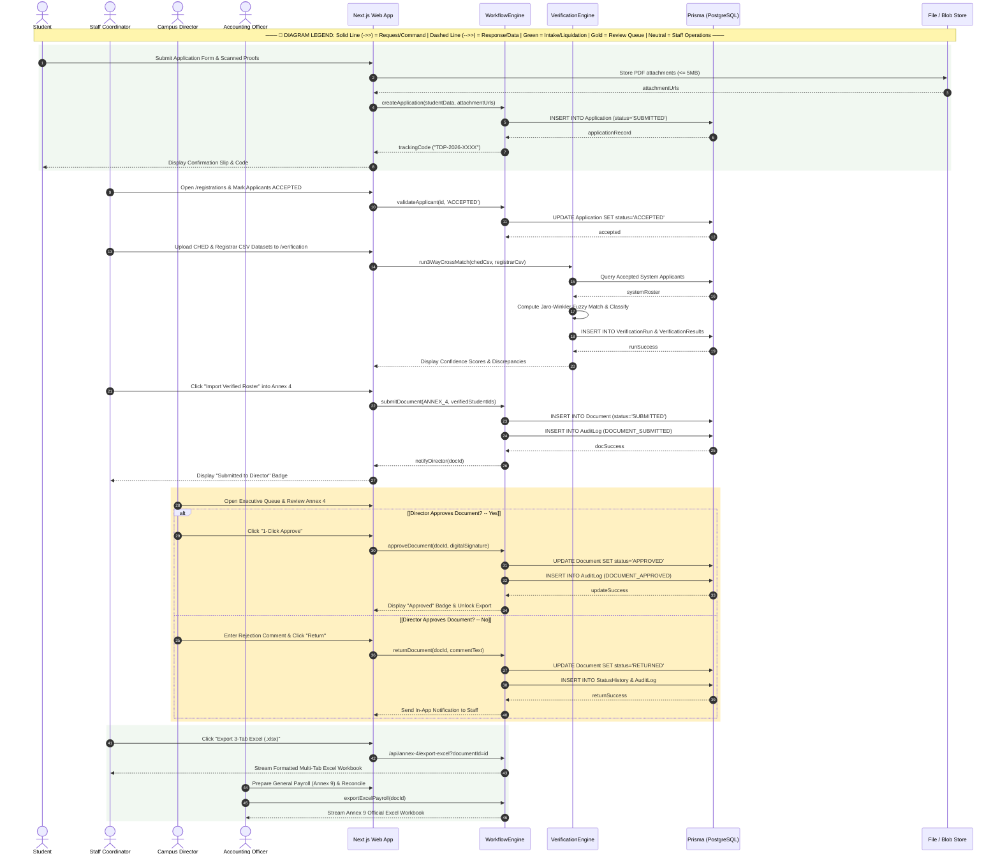
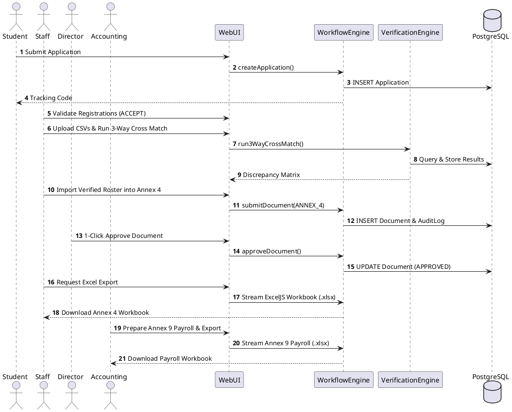

# Sequence Diagram: MinSU DocTrack Whole System

## 1. Description
This sequence diagram illustrates the chronological message exchange between actors, user interfaces, backend controllers, validation engines, database adapters, and external storage across a full document lifecycle, including student validation, 3-way verification, executive approval, and multi-tab Excel export.

## 2. ASD-STE100 Technical Specifications
- Order participants from left to right according to execution initiation.
- Draw synchronous calls with solid arrows and returns with dashed arrows.
- Enforce audit event emission for every status modification.
- Handle decision branches with `alt` and `opt` frames.

---

## 3. End-to-End System Sequence Diagram (Mermaid)

---

## 4. PlantUML System Sequence Diagram

