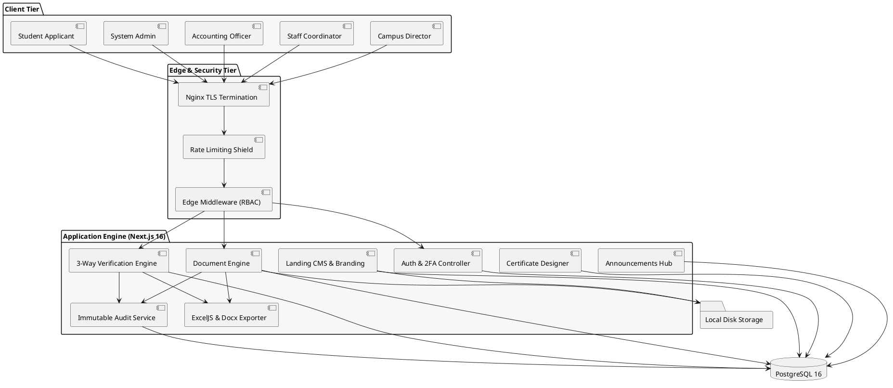

# System Architecture Diagram

> **System:** MinSU DocTrack — Document Tracking & Annex Management  
> **Diagram Type:** System Architecture Diagram  
> **Standard:** C4 / Informal Architecture Model

---

## 1. Purpose

The System Architecture Diagram shows the main components of MinSU DocTrack. It shows user clients, the edge proxy, application servers, verification engines, document compilers, databases, and external agency links.

---

## 2. Architecture Diagram

```mermaid
flowchart TB
    %% Styling Classes
    classDef clientStyle fill:#F1F8F1,stroke:#1B5E20,stroke-width:2px,color:#1F2A24;
    classDef edgeStyle fill:#FFF1C2,stroke:#F2B705,stroke-width:2px,color:#1F2A24;
    classDef appStyle fill:#FFFFFF,stroke:#1B5E20,stroke-width:2px,color:#1F2A24;
    classDef dataStyle fill:#DCEFDD,stroke:#123F17,stroke-width:2px,color:#123F17;
    classDef extStyle fill:#F6F8F6,stroke:#55645B,stroke-width:2px,stroke-dasharray: 5 5,color:#1F2A24;

    subgraph CLIENT_TIER["Client Tier (Web Browsers)"]
        DirectorUser["Campus Director<br/>(Review & Analytics)"]:::clientStyle
        StaffUser["Staff Coordinator<br/>(Annexes & Verification)"]:::clientStyle
        AccountingUser["Accounting Officer<br/>(Financial Annexes 6-9)"]:::clientStyle
        AdminUser["System Admin<br/>(Users, CMS & Security)"]:::clientStyle
        StudentUser["Student Applicant<br/>(Portal, 2FA & Profile)"]:::clientStyle
    end

    subgraph EDGE_TIER["Edge & Reverse Proxy Tier"]
        NginxProxy["Reverse Proxy / TLS Termination<br/>(Nginx / HTTPS 443)"]:::edgeStyle
        RateLimiter["Rate Limiting Shield<br/>(Anti-Brute-Force Guard)"]:::edgeStyle
        NextMiddleware["Edge Middleware<br/>(RBAC & Security Headers)"]:::edgeStyle
    end

    subgraph APP_TIER["Application Tier (Node.js / Next.js Fullstack Engine)"]
        subgraph RSC_LAYER["React Server Components Layer"]
            DashboardPages["Admin, Staff & Accounting Dashboards"]:::appStyle
            PortalPages["Student Portal & Public Landing CMS"]:::appStyle
            DesignerPages["Certificate Designer & Split CMS Editor"]:::appStyle
        end

        subgraph API_LAYER["Route Handlers & Server Actions"]
            AuthModule["Auth & 2FA Controller<br/>(Bcrypt, Sessions & TOTP)"]:::appStyle
            DocController["Document Engine<br/>(Annexes 1 to 10 CRUD)"]:::appStyle
            VerifyEngine["3-Way Verification Engine<br/>(CHED / Registrar Tripartite Match)"]:::appStyle
            CertService["Certificate Designer Engine<br/>(Signatories & Paper Layouts)"]:::appStyle
            AnnouncementService["Announcements Engine<br/>(Category Ticker & Push Feed)"]:::appStyle
            ExportEngine["Multi-Format Document Exporter<br/>(ExcelJS Workbooks & Word Docx)"]:::appStyle
            AuditService["Audit Log Service<br/>(Immutable Action Ledger)"]:::appStyle
            LandingService["Landing CMS & Branding Engine<br/>(Section Manager & Logo Store)"]:::appStyle
        end
    end

    subgraph DATA_TIER["Data & Storage Tier"]
        PrismaClient["Prisma ORM Client (v6)"]:::dataStyle
        PostgresDB[("PostgreSQL Database (Port 5432)<br/>minsu_doctrack")]:::dataStyle
        LocalStorage[("Local Secure Volume<br/>(/uploads/signed-scans, /logos)")]:::dataStyle
    end

    subgraph EXTERNAL_TIER["External Stakeholders & Services"]
        GoogleDrive["External Google Drive<br/>(Transmittal Repositories)"]:::extStyle
        CHEDUniFAST["CHED / UniFAST Regional Office<br/>(Official Sub-Allotments)"]:::extStyle
        COAAuditor["COA Resident Auditor<br/>(Post-Disbursement Clearances)"]:::extStyle
    end

    %% Client to Edge Connections
    DirectorUser -->|HTTPS| NginxProxy
    StaffUser -->|HTTPS| NginxProxy
    AccountingUser -->|HTTPS| NginxProxy
    AdminUser -->|HTTPS| NginxProxy
    StudentUser -->|HTTPS| NginxProxy

    NginxProxy --> RateLimiter
    RateLimiter --> NextMiddleware
    NextMiddleware --> RSC_LAYER
    NextMiddleware --> API_LAYER

    %% Internal Application Connections
    DashboardPages --> DocController
    DashboardPages --> VerifyEngine
    DashboardPages --> AuthModule
    PortalPages --> AuthModule
    DesignerPages --> CertService
    DesignerPages --> LandingService

    DocController --> AuditService
    DocController --> ExportEngine
    VerifyEngine --> ExportEngine
    VerifyEngine --> AuditService
    CertService --> AuditService
    LandingService --> AuditService

    DocController --> PrismaClient
    VerifyEngine --> PrismaClient
    AuthModule --> PrismaClient
    CertService --> PrismaClient
    AnnouncementService --> PrismaClient
    LandingService --> PrismaClient
    AuditService --> PrismaClient

    %% Data Connections
    PrismaClient -->|Prisma Engine / TCP 5432| PostgresDB
    DocController -->|Store Scanned PDFs| LocalStorage
    LandingService -->|Store Brand Logos| LocalStorage

    %% External Connections
    StaffUser -.->|Uploads Scanned Transmittal| GoogleDrive
    DocController -.->|Logs Shared Link| GoogleDrive
    StaffUser -.->|Physical Dispatch & Manifest| CHEDUniFAST
    AccountingUser -.->|Submits Annexes 6-8| COAAuditor

    %% ─── 📌 VISUAL LEGEND ───
    subgraph LEGEND ["📌 Diagram Legend"]
        direction TB
        L_Client["Client Tier Actor / UI"]:::clientStyle
        L_Edge["Edge / Security / Proxy Gateway"]:::edgeStyle
        L_App["Application Server Component"]:::appStyle
        L_Data[("Persistent Storage / Database")]:::dataStyle
        L_Ext["External Stakeholder / Service"]:::extStyle
    end
```

---

## 3. Diagram Legend & Symbol Guide

| Visual Symbol | Syntax / Style | UML Concept | MinSU System Implementation |
|---|---|---|---|
| `Actor` | `Client Tier` | User clients accessing the web system | Director, Staff, Accounting, Admin, Student |
| `Edge Node` | `Edge Tier` | Security, rate limiting, and TLS gateway | Nginx, In-Memory Rate Limiter, Next.js Edge Middleware |
| `Component` | `Application Tier` | Business logic services and controllers | Document Engine, 3-Way Verification Engine, 2FA Controller, ExcelJS Exporter |
| `Database` | `Data Tier` | Relational storage and file volumes | PostgreSQL database container, persistent `/uploads` volume |
| `External System` | `External Tier` | External governing agencies | CHEDRO MIMAROPA, UniFAST, COA Resident Auditor, Google Drive |

---

## 4. PlantUML Architecture Diagram

