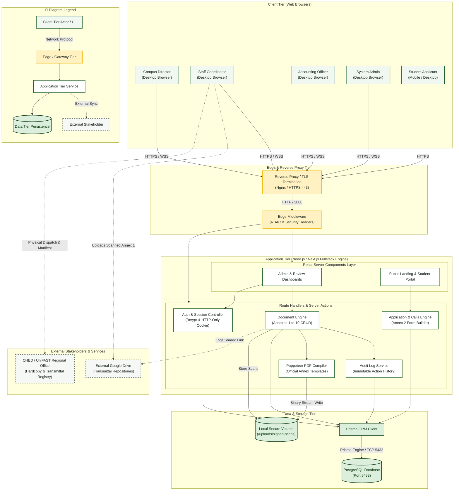

# System Architecture Diagram

> **System:** MinSU DocTrack — Document Tracking & Annex Management  
> **Diagram Type:** System Architecture Diagram  
> **Standard:** C4 / Informal Architecture Model

---

## 1. Purpose

The System Architecture Diagram shows the main components of MinSU DocTrack. It shows user clients, the application server, the database, and external agency links.

---

## 2. Architecture Diagram

---

## 3. Diagram Legend & Symbol Guide

| Visual Symbol | Syntax / Style | Architectural Tier | MinSU System Implementation |
|---|---|---|---|
| 🟩 Soft Green Box | `fill:#F1F8F1, stroke:#1B5E20` | Client Presentation Tier | Browser clients for Student, Staff, Director, Accounting, and Admin |
| 🟨 Gold Box | `fill:#FFF1C2, stroke:#F2B705` | Edge & Security Gateway Tier | Nginx TLS termination reverse-proxy and Next.js edge RBAC middleware |
| ⬜ White Box | `fill:#FFFFFF, stroke:#1B5E20` | Core Application Tier | Next.js Server Components, Document Engine, Auth Controller, PDF Compiler |
| 🟩 Dark Green Cylinder | `fill:#DCEFDD, stroke:#123F17` | Persistent Data Tier | PostgreSQL 16 relational database (Port 5432) and local storage volumes |
| ◻️ Dashed Border Box | `stroke-dasharray: 5 5` | External Stakeholder / Boundary | CHED/UniFAST regional office and external Google Drive transmittal archive |
| `-->` Solid Arrow | Network & Internal Call | Synchronous HTTPS, WSS, HTTP (port 3000), or TCP (port 5432) |
| `-.->` Dashed Arrow | Out-of-Band Integration | Physical courier shipment or external cloud drive URL synchronization |

---

## 4. Component Descriptions

- **Client Tier**: Web browsers connect over secure HTTPS.
- **Edge Tier**: Nginx terminates TLS connections. Next.js middleware verifies session tokens and role permissions.
- **Application Tier**: Next.js combines React Server Components and server routes.
- **Data Tier**: Prisma ORM executes typed queries against PostgreSQL. Local file volumes hold signed document scans.
- **External Tier**: Staff upload approved Annex 1 packages to external Google Drive storage and notify CHED.

---

## 5. STE Rules Applied

- The diagram shows high-level parts only.
- Each connection shows the data protocol.
- Component names are singular and clear.
- Paragraphs contain six sentences or fewer.
