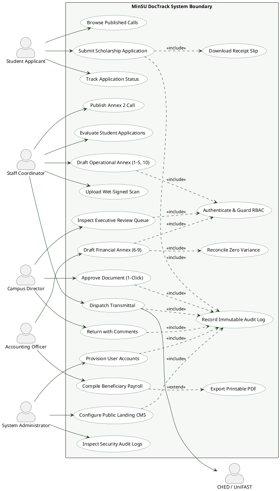
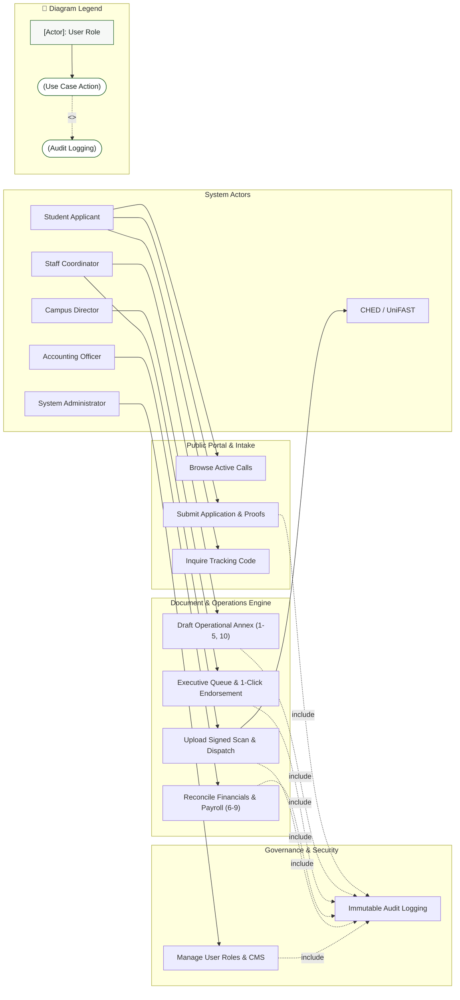

# Use Case Diagram: MinSU DocTrack Whole System

## 1. Description
This comprehensive Use Case diagram models the system boundaries, actors, goals, and interactions across the entire MinSU DocTrack application. It captures how internal staff, students, executives, accounting officers, administrators, and external agencies collaborate across the document lifecycle.

## 2. ASD-STE100 Technical Specifications
- Position actors outside the system boundary rectangle.
- Name each use case with a verb and a noun.
- Connect use cases with `<<include>>` and `<<extend>>` relationship stereotypes.
- Avoid direct associations between two actor instances.

---

## 3. System Use Case Diagram (PlantUML)

---

## 4. Use Case Overview (Mermaid)

---

## 5. Diagram Legend & Symbol Guide

| Visual Symbol | Syntax / Style | UML Use Case Concept | MinSU System Implementation |
|---|---|---|---|
| `actor` / `[Actor]` | External Role | User or external system triggering use cases | Student, Staff Coordinator, Campus Director, Accounting, Admin, CHED Agency |
| `usecase` / `(["(Action)"])` | Use Case Unit | Distinct capability or user goal | `Browse Calls`, `Submit Application`, `1-Click Endorsement`, `Reconcile Financials` |
| `-->` Solid Arrow | Actor Association | User initiates or receives data from the use case | `Student --> UC_Apply`, `Director --> UC_Approve`, `Staff --> UC_Dispatch` |
| `..>` / `-.->` Dashed Arrow | Stereotyped Dependency | Relationship between two use cases | `<<include>>` (Mandatory invocation) or `<<extend>>` (Optional augmentation) |
| `<<include>>` | Mandatory Inclusion | Always executed as part of base use case | Every mutation includes `Record Immutable Audit Log` & `Authenticate` |
| `<<extend>>` | Optional Extension | Conditionally extends base use case | Payroll compilation optionally triggers `Export Printable PDF` |

---

## 6. Use Case Descriptions
- **Submit Scholarship Application**: Allows students to provide demographic information and upload PDF/image proofs within active deadlines.
- **Draft Operational Annex**: Allows staff coordinators to aggregate student records into CHED-compliant masterlists.
- **Executive Queue & 1-Click Endorsement**: Gives campus directors an accelerated approval workflow with electronic verification.
- **Reconcile Financials & Payroll**: Enforces zero variance between disbursements and CHED fund allocations for accounting officers.
- **Dispatch Transmittal**: Packages approved annexes, attaches courier tracking metadata, and delivers records to external oversight agencies.
