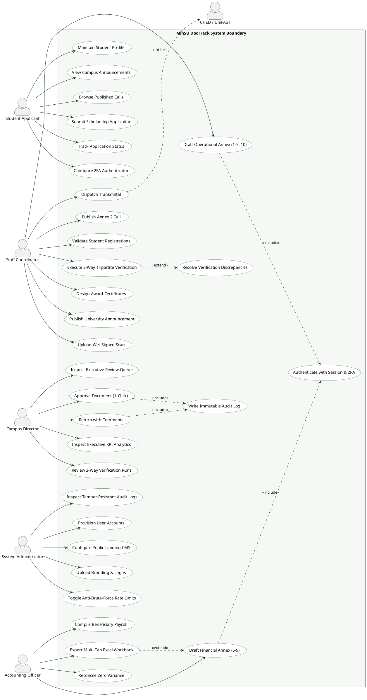
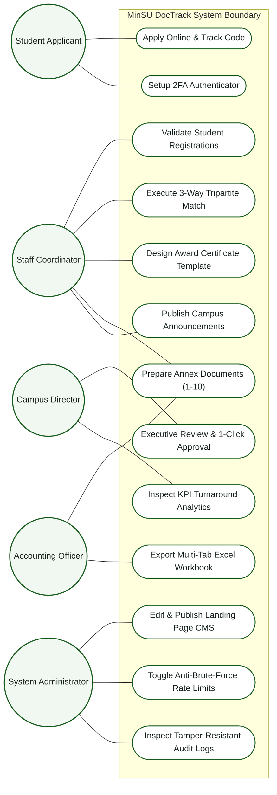

# Use Case Diagram: MinSU DocTrack Whole System

## 1. Description
This comprehensive Use Case diagram models the system boundaries, actors, goals, and interactions across the entire MinSU DocTrack application. It captures how internal staff, students, executives, accounting officers, administrators, and external agencies collaborate across the document lifecycle, 3-way verification, certificate design, and announcements.

## 2. ASD-STE100 Technical Specifications
- Position actors outside the system boundary rectangle.
- Name each use case with a verb and a noun.
- Connect use cases with `<<include>>` and `<<extend>>` relationship stereotypes.
- Avoid direct associations between two actor instances.

---

## 3. System Use Case Diagram (PlantUML)

---

## 4. Mermaid System Use Case Diagram

---

## 5. Diagram Legend & Symbol Guide

| Visual Symbol | UML Concept | MinSU Domain Meaning |
|---|---|---|
| `Actor` | External Human User | Student, Staff, Campus Director, Accounting Officer, System Admin |
| `Use Case` | Functional Capability | 3-Way Verification, Certificate Design, Registration Validation, Excel Export |
| `<<include>>` | Mandatory Sub-action | Authenticate with session and write immutable audit trail |
| `<<extend>>` | Optional Flow | Resolve discrepancies, export multi-tab Excel workbooks |
